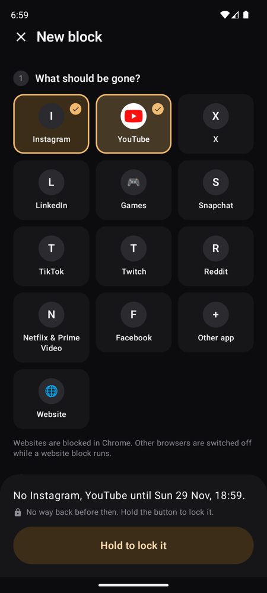

# Hafen

**A calm Android home screen that makes the apps you choose impossible to use, for as long as you choose.**

"No Instagram this week" should mean no Instagram this week. Not "until I find the off switch at 1 a.m.". Hafen locks the apps and websites you pick for a set time, and makes the rest of the phone quieter, without adding friction to the things you actually need.

<p>
  
  
  
  
  
</p>

## What it does

- **Blocks that can't be undone.** Pick apps or websites (Instagram, YouTube, X, games, any app, any site) and a duration. Once locked, a block can be extended but never shortened, paused or removed. Not in settings, not by uninstalling, not by changing the clock.
- **Daily rhythms.** Block something only at certain times, e.g. weekdays 08:00–18:00, until a date.
- **Partner code.** Someone you trust sets a code only they know. With it they can end a block early in an emergency. Nobody can set a new code while blocks run.
- **Settings lock.** Lock all settings until a date: until then everything can only get stricter.
- **Home screen.** Your favorite apps as plain text, everything else one swipe away with search. Blocked apps are greyed out with the time they come back.
- **Notification filter.** Only the apps you allow can buzz you. The rest is collected quietly and readable at times you choose (e.g. 12–13 and 20–21). Blocked apps never notify.
- **Grayscale.** Always, at set times, or only while certain apps are open.
- **Evening nudge.** After a time you choose, opening an app from "all apps" first suggests reading a book instead. Never for your essentials or home screen favorites.
- **Stats.** Screen time, unlocks, blocked attempts, time of day, and a breakdown per app and per day. Kept on the phone only.
- **Essentials.** Calls, messages, keyboard, clock and settings can never be blocked. You add the rest (banking, authenticator, maps).

Nothing leaves the phone. Hafen has no account, no server and no analytics.

## How it enforces

Android doesn't let apps block other apps, so Hafen uses the tools Android gives to accessibility and admin apps. There are two modes:

| | **Soft mode** (default) | **Device Owner** |
|---|---|---|
| Setup | Works on any phone, your accounts stay | Phone must have **no accounts** while setting up |
| Blocked app | Opens for a split second, then you're sent home | Switched off and greyed out by Android |
| Websites | Hafen reads Chrome's address bar and leaves blocked sites | Chrome itself refuses to load them |
| Uninstall / switching Hafen off | Android refuses to uninstall; Hafen leaves its own settings screens while something is locked | Not possible at all |
| Known way around it | Safe mode (boots without Hafen) | Factory reset from recovery (wipes the phone) |

Clock changes don't help in either mode: Hafen measures time against Android's network time.

Be honest with yourself about the limits: in soft mode a determined person can get around Hafen by booting into safe mode. It is built to stop the 1 a.m. impulse, not a planned escape.

## Setup

You need a computer with [adb](https://developer.android.com/tools/adb), USB debugging enabled on the phone, and JDK 17.

```bash
git clone <this repo> && cd <repo>
adb devices                      # find your phone's serial
./setup.sh <serial>              # soft mode (recommended)
./setup.sh <serial> --owner      # Device Owner, only on a phone without accounts
```

The script builds the app, installs it and grants the permissions it needs over adb:

| Permission | What for |
|---|---|
| Accessibility service | Sees which app is in front: blocks, nudge, grayscale per app, Reels detection |
| Device admin | Android won't uninstall Hafen while it's active |
| `WRITE_SECURE_SETTINGS` | Grayscale, and switching its own watcher back on |
| Notification access | The notification filter |
| Usage access | History for the stats |

Then open Hafen › **Settings › Protection status**: everything should be green.

Optional: make Hafen your home screen under Settings › Home & notifications.

## Before you lock anything

- **Start unarmed.** Every change applies immediately until you switch on *Armed* (Settings › Strictness & partner code). Set everything up first.
- **Add your essentials** (banking, 2FA, maps) before blocking categories like games.
- **Test with a short block** ("rest of today") first.
- **This is a test-only build.** While it is, `adb shell dpm remove-active-admin dev.anchor/.enforce.AdminReceiver` followed by `adb uninstall dev.anchor` removes it from a connected computer. That's your safety net while you try it out. A release build closes that door, so keep your signing key safe: without it you can never update the app again.

## Not on the Play Store

Hafen uses permissions the Play Store doesn't allow for this kind of app (accessibility tool, secure settings). It is meant to be built and installed by you, for yourself.

## Building and tests

```bash
./gradlew :app:assembleDebug      # APK in app/build/outputs/apk/debug/
./gradlew :app:testDebugUnitTest  # strictness rules: what counts as loosening, blocks can't shrink
```

Kotlin, Jetpack Compose, Android 10+ (minSdk 29). The policy logic lives in `app/src/main/java/dev/anchor/policy/`, enforcement in `enforce/` and `service/`, screens in `ui/`.

## License

See [LICENSE](LICENSE).
