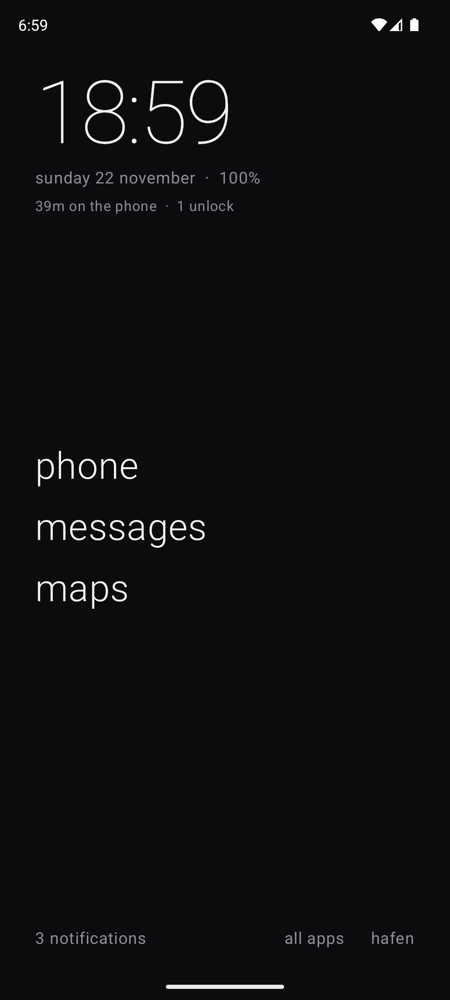
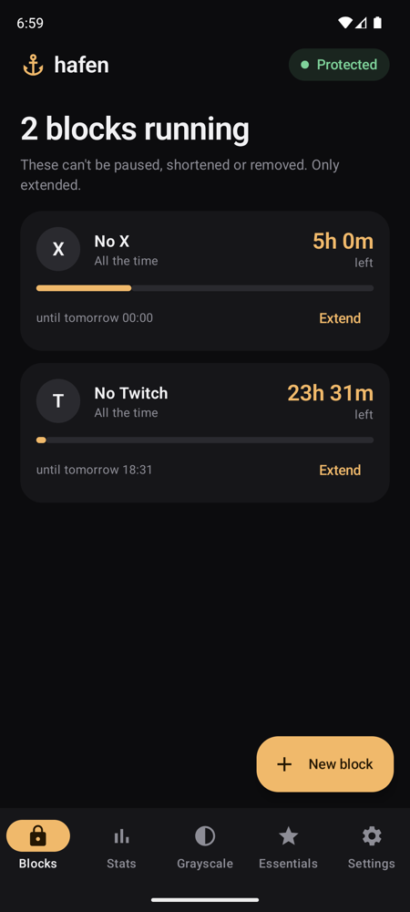
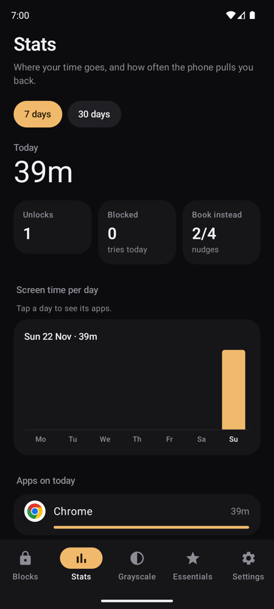
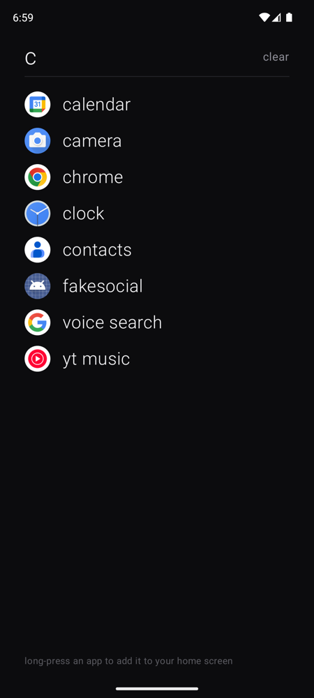
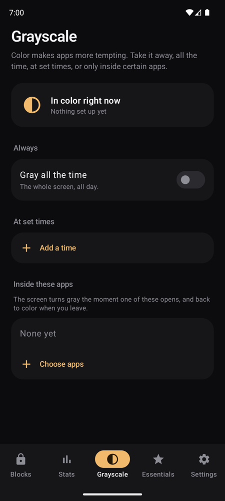
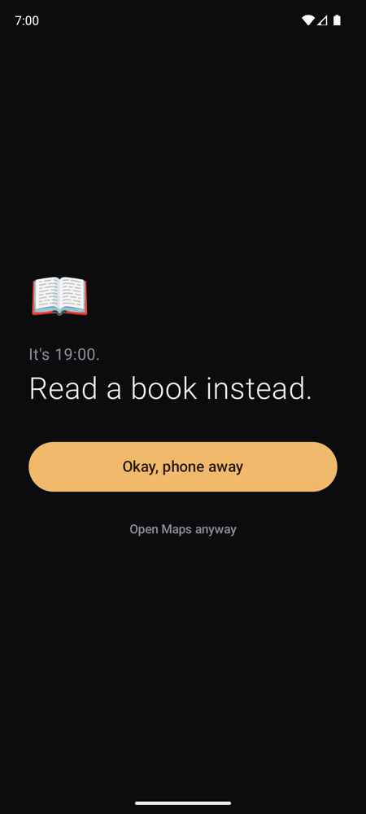

<div align="center">

# ⚓ Hafen

**Lock the apps you choose, for as long as you choose. Keep everything else calm and quick.**

[](LICENSE)


&nbsp;
&nbsp;
&nbsp;


</div>

---

"No Instagram this week" should mean **no Instagram this week**, not "until I find the off switch at 1 a.m.".

Most screen-time apps add friction: timers, pop-ups, "are you sure?". Friction is easy to click through on a weak evening, and it gets in the way of the things you actually need. Hafen does the opposite:

- **Hard where it matters.** The apps and sites you lock are gone until the time is up. There is no snooze button, and no settings toggle that undoes it.
- **Zero friction everywhere else.** Messages, maps, banking, the camera: one tap, no waiting, no questions.
- **Calm by default.** A text-only home screen, notifications that wait until you're ready for them, and grayscale when you want it.

Hafen is German for *harbour*: a quiet place to tie up the boat.

## Contents

- [Features](#features)
- [How it holds](#how-it-holds)
- [Install on your phone](#install-on-your-phone-no-computer)
- [Quick start (with a computer)](#quick-start-with-a-computer)
- [Before you lock anything](#before-you-lock-anything)
- [FAQ](#faq)
- [Building and contributing](#building-and-contributing)
- [Roadmap](#roadmap)

## Features

### 🔒 Blocks that can't be undone
Pick apps or websites (Instagram, YouTube, X, TikTok, Reddit, all games, any app, any site) and a duration: rest of today, a week, a month, or any number of days. Hold the button to lock it.

While a block runs it can be **extended, never shortened, paused or removed**. Not in settings, not by uninstalling, not by moving the clock.

**Daily rhythms:** block only at certain times, for example weekdays 08:00–18:00, until a date.

### 🤝 Partner code
Someone you trust sets a code only they know. It's the emergency exit: with it they can end a block or the settings lock early. Every use is logged, wrong guesses lock the code for longer and longer, and **nobody can set a new code while a block runs**.

### 🏠 A calm home screen
- Big clock, battery, your next alarm, today's screen time and unlocks.
- Your favorite apps as plain text.
- **All apps** one swipe away, with instant search: type two letters, press Enter.
- Blocked apps are greyed out and show when they come back.

&nbsp;
&nbsp;


### 🔕 Notifications on your schedule
Only the apps you allow can buzz you. Everything else is collected quietly and becomes readable at times you pick, for example 12–13 and 20–21. Notifications from blocked apps and blocked websites never show up at all.

### 🌗 Grayscale
Always, at set times (say 20:00–08:00), or only while certain apps are open. Colour makes feeds more tempting; take it away.

### 📖 Evening nudge
After a time you choose, opening an app from "all apps" first asks whether you'd rather read. *Okay, phone away* turns the screen off. Never for your essentials or your home screen favorites.

### 📊 Stats
Screen time per day against your average, unlocks, blocked attempts, the hours you use your phone, and a breakdown **per app and per day**. The history is kept on the phone and archived daily.

### ⭐ Essentials
Phone, messages, keyboard, clock and settings can never be blocked. You add the rest: banking, authenticator apps, maps. Essentials are never touched by game detection, bedtime or the evening nudge.

### 🛡️ Settings lock
Lock all settings until a date. Until then every rule can only get stricter. Without a lock, anything that loosens a rule waits 24 hours once Hafen is *armed*.

**Privacy:** nothing leaves the phone. No account, no server, no analytics, no ads.

## How it holds

Android doesn't let one app switch off another, so Hafen uses the tools Android gives accessibility and admin apps. It runs in one of two modes:

| | **Soft mode** (default) | **Device Owner** |
|---|---|---|
| Setup | Any phone, your accounts stay | The phone must have **no accounts** while you set it up |
| A blocked app | Opens for a split second, then you're back home | Switched off and greyed out by Android itself |
| Blocked websites | Hafen reads Chrome's address bar and leaves the page | Chrome refuses to load them |
| Uninstalling Hafen | Android refuses; Hafen leaves its own settings screens while something is locked | Impossible |
| Clock tricks | Ignored: Hafen uses Android's network time | Ignored |
| The known way around | **Safe mode** (boots without Hafen) | Factory reset from recovery (wipes the phone) |

Hafen is built to stop the 1 a.m. impulse, not a planned escape. If you're determined to get around it in soft mode, safe mode will let you. Knowing that, most evenings it simply works.

## Install on your phone (no computer)

1. On your phone, download **Hafen-0.9.1.apk** from the [latest release](https://github.com/paulnispelwork/hafen/releases/latest) and open it. Allow installing from your browser when Android asks.
2. Open Hafen. A short checklist walks you through the permissions, each with a button to the right Android screen.
3. Android 13+: if a step says "Restricted setting", open App info › ⋮ › **Allow restricted settings**, then try again.

Updates: download the newer APK from Releases and open it; your blocks and settings stay. Moving phones? Settings › Setup & status › **Back up settings**, then **Restore from backup** on the new phone.

Everything works this way except grayscale and self-repair, which need one permission only a computer (or wireless debugging) can grant. The checklist shows how.

## Quick start (with a computer)

You need a computer with [adb](https://developer.android.com/tools/adb), **USB debugging** switched on on the phone, and **JDK 17**.

```bash
git clone https://github.com/paulnispelwork/hafen.git
cd hafen
adb devices                  # note your phone's serial
./setup.sh <serial>          # soft mode (recommended)
```

`./setup.sh <serial> --owner` sets up Device Owner instead, but only on a phone without accounts.

The script builds the app, installs it and grants what it needs over adb:

| Permission | Used for |
|---|---|
| Accessibility service | Knowing which app is in front: blocks, website check, nudge, grayscale per app |
| Device admin | Android won't uninstall Hafen while it's active |
| `WRITE_SECURE_SETTINGS` | Grayscale, and switching its own watcher back on |
| Notification access | The notification filter |
| Usage access | History for the stats |

Then open Hafen, go to **Settings › Protection status**, and check that everything is green. To use Hafen as your home screen: **Settings › Home & notifications › Use Hafen as home screen › Make default**.

## Before you lock anything

1. **Start unarmed.** Until you switch on *Armed* (Settings › Strictness & partner code), every change applies at once. Set everything up first.
2. **Add your essentials** (banking, 2FA, maps) before you block whole categories like games.
3. **Try a short block first:** "rest of today".
4. **Hand over the partner code** before your first long block, if you want an emergency exit at all.
5. **This is a test-only build.** While it is, a connected computer can still remove it:
   ```bash
   adb shell dpm remove-active-admin dev.anchor/.enforce.AdminReceiver
   adb uninstall dev.anchor
   ```
   That's your safety net while you try it out. A release build closes that door, so back up your signing key first: without it you can never update the app.

## FAQ

**Does it work with banking and 2FA apps?**
Yes. Add them to Essentials and they're never touched. Some banking apps warn about accessibility apps they don't know. If one refuses to run, tell us which one.

**What if I lose the partner code?**
Running blocks simply run to their end. A new code can be set once no block and no settings lock are running.

**Can I change a block I set by mistake?**
You can extend it, not shorten it. That's the point, and also why the lock button has to be held. If you made a real mistake, the partner code ends it.

**Why isn't it on the Play Store?**
It uses permissions Google doesn't allow for this kind of app: an accessibility tool that guards its own settings, and secure-settings access. You build and install it yourself, for yourself.

**Does it drain the battery?**
Not noticeably. Hafen reacts to app switches as they happen and does a full check once a minute.

**Which phones?**
Android 10 and newer. Developed on a Pixel 8a (Android 17) and the Android 16 emulator. Other launchers' gesture navigation can behave slightly differently.

## Building and contributing

```bash
./gradlew :app:assembleDebug        # APK in app/build/outputs/apk/debug/
./gradlew :app:testDebugUnitTest    # the strictness rules: what counts as loosening, blocks can't shrink
./gradlew :app:lintDebug
```

Kotlin and Jetpack Compose, minSdk 29.

| Folder | What's in it |
|---|---|
| `app/src/main/java/dev/anchor/policy/` | The rules: policy model, what counts as loosening, trusted time, merging edits |
| `app/src/main/java/dev/anchor/enforce/` | Applying the rules: blocks, grayscale, alarms, stats, notification inbox |
| `app/src/main/java/dev/anchor/service/` | The accessibility watcher, notification filter, optional DNS filter |
| `app/src/main/java/dev/anchor/ui/` | All screens, including the home screen and the evening nudge |

Issues and pull requests are welcome. Two ground rules:
- Nothing may make a running block shorter or easier to remove. Changes to `policy/Strictness.kt` need a test.
- No network calls, no analytics.

## Roadmap

- [ ] Release build with a proper signing setup
- [ ] German translation (the app is English today)
- [ ] F-Droid
- [ ] Optional black wallpaper during setup, so Android's own overview stays calm too

## License

[MIT](LICENSE)
